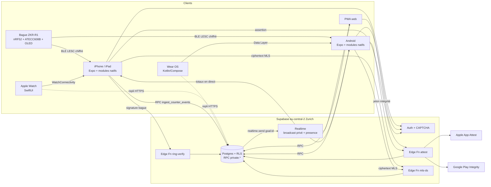
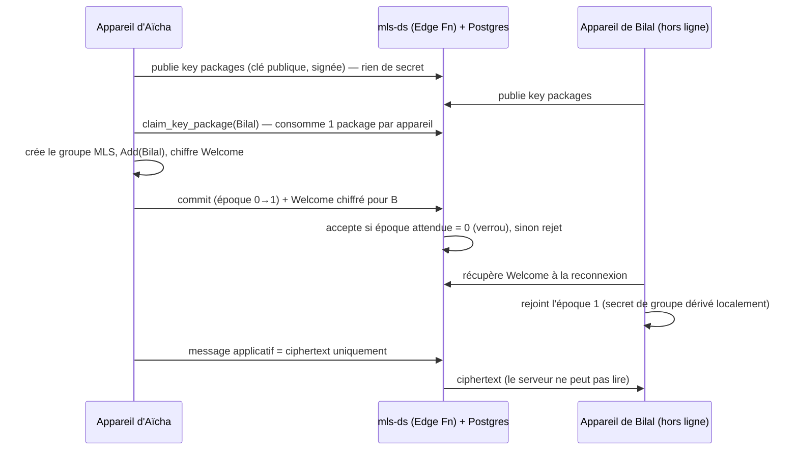
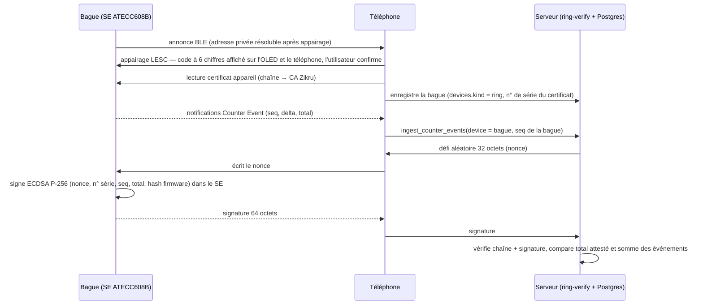

# Zikru — Architecture & feuille de route

Version 0.1 · 28.10.2026 · document de travail pour Mohamed (fondateur)
Statut : proposition d'architecture. Rien de ce qui est décrit ici n'est encore en production, sauf mention contraire. Le code P1 est dans `docs/p1-groups/` (testé, non appliqué).

> Ce document contient des éléments juridiques (marques, protection des données, licences). Ce n'est pas un avis juridique. Faire valider par un mandataire en propriété intellectuelle et un avocat suisse en protection des données avant tout dépôt ou lancement.

## Sommaire

1. Stack technique
2. Architecture d'ensemble (diagrammes)
3. Protocole BLE « ZKR-R1 » v0
4. Modèle de données (esquisse SQL + RLS)
5. Sécurité, menaces, nLPD/RGPD, anti-abus
6. Juridique et propriété intellectuelle
7. Feuille de route P0 → P6
8. Code P1 (groupes + compteur temps réel)
9. Questions ouvertes

---

## 1. Stack technique

### 1.1 Décisions

| Domaine | Choix | Pourquoi | Alternative écartée |
|---|---|---|---|
| App iPhone / iPad / Android / PWA | Expo SDK 58 (React Native 0.88, expo-router), « development builds » + modules natifs Expo (Swift / Kotlin) | Base existante, un seul code UI, modules natifs quand il le faut (BLE, montres, crypto) | Réécriture native : coût ×2–3 |
| Apple Watch | App SwiftUI native (cible watchOS ajoutée par un config plugin, p. ex. `@bacons/apple-targets`), WatchConnectivity + repli direct serveur | React Native ne tourne pas sur watchOS | — |
| Wear OS | App Kotlin + Compose for Wear OS, Data Layer API (MessageClient / DataClient) + repli direct serveur | Standard Google ; nécessite même `applicationId` et même clé de signature que l'app téléphone | Tizen / autres : hors périmètre |
| Bague ZKR-R1 | nRF52840 ou nRF5340 (Nordic, nRF Connect SDK / Zephyr) + élément sécurisé ATECC608B ou SE050 + OLED | BLE 5, LESC, DFU signée (MCUboot), écosystème mature | ESP32 : consommation plus élevée pour une bague |
| Chiffrement de bout en bout | OpenMLS (Rust, RFC 9420, licence MIT) dans une crate `zikru-crypto`, liée via uniffi (Swift + Kotlin) | Groupes natifs, multi-appareils, licence permissive | libsignal : AGPL-3.0 (voir 1.4) |
| Backend | Supabase, projet en `eu-central-2` (Zurich) : Postgres + RLS, Auth, Realtime (broadcast privé + presence), Edge Functions | Déjà en place, données hébergées en Suisse | Serveur maison : plus d'exploitation |
| Edge Functions | `attest` (App Attest / Play Integrity), `mls-ds` (service de distribution MLS), `ring-verify` (P5) | Logique qui ne doit pas tourner sur le client | — |
| IA « Bilal » | Inchangée (Edge Function existante, quota en base) | — | — |

### 1.2 App mobile (Expo)

- Passer aux development builds (`expo-dev-client`) partout : les modules natifs (montres, MLS, BLE avancé, attestation) ne tournent pas dans Expo Go.
- Modules natifs maison via l'Expo Modules API : `zikru-watch` (WatchConnectivity / Data Layer), `zikru-crypto` (bindings uniffi d'OpenMLS), `zikru-attest` (DCAppAttestService / Play Integrity).
- BLE : on garde `react-native-ble-plx`. L'appairage (LESC) est géré par l'OS ; l'app ne choisit pas la méthode, c'est la capacité d'entrée/sortie de la bague qui la détermine (voir §3).
- Hors-ligne d'abord : file d'événements persistée (AsyncStorage pour P1 ; SQLite chiffré à partir de P3 pour l'état MLS).
- iPad : corriger les barres latérales et boutons coupés (P0, en cours en parallèle).

### 1.3 Montres

Apple Watch (SwiftUI) :
- Compteur au tap ou à la Digital Crown, retour haptique, complications WidgetKit.
- WatchConnectivity : `sendMessage` quand l'iPhone est joignable (temps réel), `transferUserInfo` sinon (livraison garantie, en file).
- Repli direct serveur : la montre a son propre `device_id` et son propre `seq`, et appelle la même RPC `ingest_counter_events` en HTTPS (URLSession). Le jeton de session est transmis une fois par l'iPhone via WatchConnectivity et stocké dans le Keychain de la montre.
- Le dédoublonnage est le même qu'au téléphone : `(device_id, seq, goal_id)`.

Wear OS (Kotlin / Compose) :
- MessageClient pour les taps en direct, DataClient pour l'état (objectif courant, total).
- Contrainte Google : l'app montre et l'app téléphone doivent avoir le même nom de paquet (`ch.mohamadba.zikru`) et la même clé de signature pour se parler via la Data Layer.
- Repli direct serveur identique (Wi-Fi / LTE de la montre).

### 1.4 Chiffrement de bout en bout (E2EE)

Recommandation : OpenMLS partout, y compris pour les messages privés (DM) sous forme de groupes MLS à 2 membres.

- OpenMLS : implémentation Rust de MLS (RFC 9420), licence MIT. Audit de sécurité indépendant par SRLabs (rapport publié en 2026, financé par la Sovereign Tech Agency) ; des avis de sécurité ont encore été publiés ensuite (GitHub Security Advisories du dépôt `openmls/openmls`). Conséquence : épingler les versions, suivre les avis, mettre à jour vite.
- Pourquoi pas libsignal : libsignal est sous AGPL-3.0. L'utiliser oblige en pratique à publier tout le code source de Zikru sous une licence compatible AGPL, et la compatibilité de la GPL/AGPL avec les conditions de l'App Store est discutée depuis l'affaire VLC (2011). À faire confirmer par un juriste si l'option revient un jour.
- Ce qu'on perd avec MLS à 2 : certaines propriétés de « déni plausible » de X3DH/PQXDH (Signal). Pour Zikru, acceptable.
- Multi-appareils : chaque appareil (iPhone, iPad, montre si elle messagerie un jour) est un client MLS distinct, une feuille de l'arbre. Ajouter un appareil = un appareil existant de l'utilisateur l'ajoute au groupe (commit Add) après vérification ; un appareil perdu est retiré (commit Remove) et ses key packages révoqués.
- Service d'authentification (AS) : c'est la vraie difficulté. MLS ne prouve pas qui est derrière une clé. V1 : identifiant = `user_id` + `device_id`, clé de signature publiée par le serveur ; vérification hors bande possible par « code de sécurité » / QR entre membres. Plus tard : transparence des clés.
- Service de distribution (DS) : Edge Function `mls-ds` + tables Postgres. Le DS sérialise les commits par groupe (verrou sur l'époque) : un commit n'est accepté que s'il vise l'époque courante.
- Ce que le serveur voit malgré tout : qui est dans quel groupe, quand, la taille des messages. C'est une limite de MLS côté métadonnées.
- Web / PWA : OpenMLS compile en WebAssembly, mais le stockage des clés dans un navigateur est plus faible. Proposition : messagerie E2EE sur les apps natives d'abord, pas sur la PWA en V1.
- Audit de notre intégration : indispensable avant lancement (prestataires spécialisés : SRLabs, Cure53, NCC Group, Trail of Bits…). Prix : sur devis, non estimé ici.

### 1.5 Supabase

- Postgres + RLS : toute la logique sensible est en fonctions `SECURITY DEFINER` dans le schéma `private` (avec `search_path = ''`), exposées par des wrappers `SECURITY INVOKER` dans `public`. Aucun droit pour `anon`.
- Realtime : broadcast privé (topics `goal:<uuid>`, contrôlés par RLS sur `realtime.messages`, `config: { private: true }` + `supabase.realtime.setAuth()`), presence pour les séances en direct. Les totaux sont publiés par le serveur avec `realtime.send(...)` ; aucun client ne peut publier sur un topic d'objectif.
- Auth : connexion existante + CAPTCHA (hCaptcha ou Cloudflare Turnstile, pris en charge nativement par Supabase Auth via `captchaToken`).
- Edge Functions : `attest`, `mls-ds`, `ring-verify`. Fixer leur région d'exécution (option `region` / en-tête `x-region`) et le documenter dans le registre des traitements.
- Clé côté client : uniquement la clé publiable. La clé `service_role` ne quitte jamais les Edge Functions.

## 2. Architecture d'ensemble

### 2.1 Vue globale



### 2.2 Flux des clés E2EE (MLS)



### 2.3 Bague : appairage, événements, attestation



---

## 3. Protocole BLE « ZKR-R1 » v0

Statut : brouillon v0, à co-définir. La bague n'existe pas encore ; ce protocole sert à développer l'app et un simulateur dès maintenant.

### 3.1 Services et caractéristiques

UUID de base propre à Zikru (généré le 28.10.2026, à figer à la v1) : `a548XXXX-5630-4ce8-b243-aab253eadd56`.

| Service / caractéristique | UUID | Propriétés | Sécurité | Contenu |
|---|---|---|---|---|
| Service Zikru Counter | `a5480100-…` | — | — | Service principal |
| Counter Event | `a5480101-…` | notify | chiffré + authentifié (MITM) | Événement de comptage (15 octets, ci-dessous) |
| Sync Control | `a5480102-…` | write, indicate | chiffré + authentifié | `ACK jusqu'à seq N` / `REPLAY depuis seq N` / état du tampon |
| Time Sync | `a5480103-…` | write | chiffré + authentifié | heure UNIX u32 + décalage fuseau i16 (minutes) |
| Config | `a5480104-…` | read, write | chiffré + authentifié | objectif, motif haptique, luminosité OLED, libellé du dhikr (index) |
| Attestation Challenge | `a5480105-…` | write | chiffré + authentifié | nonce 32 octets venant du serveur |
| Attestation Response | `a5480106-…` | read, indicate | chiffré + authentifié | signature ECDSA P-256 (64 octets) + champs signés |
| Device Certificate | `a5480107-…` | read (lecture longue) | chiffré | certificat appareil (format compressé Microchip ou X.509 DER) |
| Battery Service (SIG) | `0x180F` / Battery Level `0x2A19` | read, notify | — | niveau 0–100 % |
| Device Information (SIG) | `0x180A` (`0x2A29` fabricant, `0x2A24` modèle, `0x2A25` série, `0x2A26` firmware, `0x2A27` matériel) | read | chiffré pour le n° de série | identité |
| DFU (MCUmgr SMP) | `8D53DC1D-1DB7-4CD3-868B-8A527460AA84` | write, notify | chiffré + authentifié | mise à jour firmware, image signée MCUboot |

MTU : demander 247 octets (iOS négocie seul ; Android : `requestMTU`). Avec le MTU par défaut (23 octets), seuls Counter Event et Sync tiennent en une trame.

### 3.2 Format « Counter Event » (little-endian, 15 octets)

| Octets | Champ | Type | Description |
|---|---|---|---|
| 0 | version | u8 | `0x00` pour v0 |
| 1–4 | seq | u32 | strictement croissant, jamais réutilisé, même après coupure d'alimentation |
| 5–6 | delta | u16 | appuis depuis l'événement précédent (1–1000) |
| 7–10 | t | u32 | heure UNIX synchronisée, `0` si inconnue (le téléphone date alors à la réception) |
| 11–14 | total | u32 | compteur cumulé depuis la remise à zéro usine |

Règles :
- La bague garde les événements non acquittés dans un tampon circulaire en flash (taille à fixer, ex. plusieurs milliers d'événements).
- Persistance de `seq` : écrite par blocs ; au démarrage, la bague reprend à « dernier bloc écrit + taille de bloc » pour ne jamais réutiliser un `seq` (des trous sont permis, pas des doublons).
- Côté serveur, l'événement devient `counter_events(device_id = bague, seq = seq de la bague, goal_id)`. Si le téléphone ET la montre relaient le même événement, la clé primaire `(device_id, seq, goal_id)` le compte une seule fois. C'est un G-counter par appareil : le total d'un objectif est la somme des événements distincts, indépendante de l'ordre d'arrivée.
- `total` permet de détecter des événements manquants (trou entre la somme des deltas reçus et le total) et sert à l'attestation.

### 3.3 Appairage LESC

- LE Secure Connections obligatoire (ECDH P-256) ; « Just Works » refusé par la bague.
- Bague = capacité « DisplayYesNo » (OLED + bouton) → Comparaison numérique : le même code à 6 chiffres s'affiche sur l'OLED et sur le téléphone, l'utilisateur confirme des deux côtés.
- Repli « Passkey Entry » : la bague affiche un code, l'utilisateur le tape sur le téléphone.
- L'app ne choisit pas la méthode : iOS/Android la déduisent des capacités annoncées. On le vérifie au test.
- Bonding : la bague garde au plus N liens ; remise à zéro des liens par appui long + confirmation sur l'OLED.
- Adresse privée résoluble (RPA) après appairage pour limiter le pistage.
- Web Bluetooth : pas disponible dans Safari iOS ; sur Chrome Android/desktop, comportement d'appairage variable. La bague passe par les apps natives.

### 3.4 Authenticité : défi-réponse avec élément sécurisé

- Élément sécurisé : Microchip ATECC608B (ECDSA P-256, clé privée non extractible ; variante pré-provisionnée « Trust&GO » avec certificats) ou NXP EdgeLock SE050 (certifié Common Criteria EAL6+ selon NXP, plus de fonctions, plus cher).
- Provisionnement en usine : la clé privée est générée dans le SE ; le certificat de l'appareil est signé par une CA « Zikru Devices » (CA racine hors ligne → CA intermédiaire de production → certificat appareil). Le n° de série du certificat est stocké dans `devices.ring_cert_serial`.
- Défi : le serveur envoie un nonce de 32 octets (usage unique, expire en 60 s). La bague signe `SHA-256("ZKR-R1/att/v0" ‖ nonce ‖ serial ‖ seq ‖ total ‖ fw_hash)`.
- Le serveur vérifie la chaîne, la signature, l'unicité du nonce, puis compare : la somme des événements reçus de cette bague ne doit pas dépasser le `total` attesté. Au-delà → événements marqués « non attestés » (pas comptés dans les classements, P5).
- Fréquence : à l'enregistrement, puis périodiquement (ex. 1×/jour ou par séance), pas à chaque appui (énergie).

### 3.5 Limites honnêtes

- Ça prouve que les appuis viennent d'une vraie bague Zikru, pas qu'une personne a récité. Un doigt mécanique sur une vraie bague passe.
- Les comptes faits à l'écran, à la montre ou au clavier ne sont pas attestés par la bague (seulement bornés en cadence et, en P4, liés à une app authentique via App Attest / Play Integrity).
- Un téléphone compromis peut retarder ou bloquer les événements (déni de service), pas en inventer de valides pour la bague.
- Attaques physiques sur le SE : coûteuses mais pas impossibles. Pas de promesse « inviolable ».
- Le n° de série de la bague est un identifiant stable : donnée personnelle, à traiter comme telle.

### 3.6 Coûts et contraintes (à chiffrer, non inventés ici)

- Composants (SoC nRF, SE, OLED, batterie, coque) : prix à relever chez les distributeurs (Mouser, DigiKey, Microchip Direct) selon volumes.
- Qualification Bluetooth SIG (Declaration ID) obligatoire pour utiliser la marque Bluetooth : montant à vérifier sur bluetooth.com.
- Conformité radio : marquage CE / directive RED pour l'UE (la Suisse reconnaît la conformité UE via l'accord de reconnaissance mutuelle ; à vérifier avec l'OFCOM), FCC si vente aux États-Unis. Un module radio pré-certifié réduit fortement ce coût.
- Batterie, charge, étanchéité, tailles de bague : contraintes mécaniques fortes, prévoir un partenaire de conception matérielle.
---

## 4. Modèle de données (esquisse)

Les groupes P1 réutilisent les tables existantes (`circles`, `circle_members`, `shared_goals`, `goal_contributions`, `aggregated_counters`, `sharing_preferences`). Le code complet et testé de P1 est dans `docs/p1-groups/sql/`. Les tables MLS, signalements et blocages ci-dessous sont une esquisse pour P3, pas encore codée.

```sql
-- ===== Existant (rappel) =====
-- circles(id, name, max_members 2..50, rules, …)          = groupes
-- circle_members(circle_id, user_id, role founder|moderator|member, …)
-- shared_goals(id, scope_type, circle_id|family_id, target, status, …)
-- sharing_preferences(user_id, scope, mode nothing|participation|counter)

-- ===== P1 (codé, testé, non appliqué) =====
create table public.group_invites (
  id uuid primary key default gen_random_uuid(),
  circle_id uuid not null references public.circles(id) on delete cascade,
  token_hash bytea not null unique,        -- sha256(jeton) ; le jeton clair n'est jamais stocké
  role text not null check (role in ('member','moderator')),
  max_uses int not null check (max_uses between 1 and 200),
  uses int not null default 0,
  expires_at timestamptz not null,         -- ≤ 7 jours
  revoked_at timestamptz,
  created_by uuid not null references public.profiles(id) on delete cascade
);
create table public.devices (               -- téléphone, tablette, montre, bague, web
  id uuid primary key, user_id uuid not null references public.profiles(id) on delete cascade,
  kind text not null check (kind in ('phone','tablet','watch','ring','web')),
  attested_at timestamptz, ring_cert_serial text
);
create table public.counter_events (
  device_id uuid not null references public.devices(id) on delete cascade,
  seq bigint not null, goal_id uuid not null references public.shared_goals(id) on delete cascade,
  user_id uuid not null, count int not null check (count between 1 and 1000),
  source text not null, occurred_at timestamptz not null,
  primary key (device_id, seq, goal_id)    -- dédoublonnage = contrainte d'unicité
);
create table public.group_planned_sessions (
  id uuid primary key, circle_id uuid not null, starts_at timestamptz not null,
  recurrence text check (recurrence in ('none','daily','weekly')), tz text not null
);
-- Séance en direct : presence Realtime sur le topic privé « session:<uuid> » (pas de table).

-- ===== P3 (esquisse) : MLS — le serveur ne stocke que du chiffré et du public =====
create table public.mls_clients (            -- un client MLS par appareil
  id uuid primary key, user_id uuid not null references public.profiles(id) on delete cascade,
  device_id uuid not null references public.devices(id) on delete cascade,
  signature_key bytea not null,              -- clé publique
  credential bytea not null, revoked_at timestamptz
);
create table public.mls_key_packages (
  id bigint generated always as identity primary key,
  client_id uuid not null references public.mls_clients(id) on delete cascade,
  ref bytea not null unique, key_package bytea not null,   -- public
  last_resort boolean not null default false,
  expires_at timestamptz not null, consumed_at timestamptz
);
create table public.mls_groups (
  id uuid primary key, kind text not null check (kind in ('dm','group')),
  circle_id uuid references public.circles(id) on delete cascade,
  epoch bigint not null default 0            -- le DS n'accepte un commit que pour l'époque courante
);
create table public.mls_group_members (       -- métadonnée visible du serveur (limite de MLS)
  group_id uuid references public.mls_groups(id) on delete cascade,
  client_id uuid references public.mls_clients(id) on delete cascade,
  primary key (group_id, client_id)
);
create table public.mls_messages (
  id bigint generated always as identity primary key,
  group_id uuid not null references public.mls_groups(id) on delete cascade,
  epoch bigint not null, sender_client uuid not null,
  kind text not null check (kind in ('commit','proposal','application')),
  ciphertext bytea not null check (octet_length(ciphertext) <= 65536),
  created_at timestamptz not null default now(),
  expires_at timestamptz not null default now() + interval '30 days'  -- purge côté serveur
);
create table public.mls_welcomes (
  id bigint generated always as identity primary key,
  target_client uuid not null references public.mls_clients(id) on delete cascade,
  group_id uuid not null, ciphertext bytea not null, consumed_at timestamptz
);

-- ===== Modération =====
create table public.reports (
  id uuid primary key default gen_random_uuid(),
  reporter uuid not null references public.profiles(id) on delete cascade,
  target_user uuid references public.profiles(id) on delete set null,
  circle_id uuid references public.circles(id) on delete set null,
  reason text not null check (reason in ('spam','harcelement','haine','mineur','autre')),
  evidence text,          -- texte que le signaleur choisit de transmettre (déchiffré chez lui)
  status text not null default 'ouvert', created_at timestamptz not null default now()
);
create table public.blocks (
  blocker uuid not null references public.profiles(id) on delete cascade,
  blocked uuid not null references public.profiles(id) on delete cascade,
  created_at timestamptz not null default now(),
  primary key (blocker, blocked), check (blocker <> blocked)
);
```

Grandes lignes RLS :

| Table | Lecture | Écriture |
|---|---|---|
| `group_invites` | modérateurs du cercle, sans la colonne `token_hash` (droits par colonne) | RPC uniquement (`create_group_invite`, `revoke_group_invite`) |
| `devices`, `counter_events` | propriétaire uniquement | RPC uniquement (`register_device`, `ingest_counter_events`) |
| `realtime.messages` | topic `goal:<id>` : membres du périmètre de l'objectif ; topic `session:<id>` : membres du cercle | aucune insertion client sur `goal:*` ; presence sur `session:*` |
| `mls_clients` | membres d'un groupe commun (clés publiques) | propriétaire (son appareil) |
| `mls_key_packages` | personne directement | insertion par le propriétaire ; consommation via RPC `claim_key_package` (`for update skip locked`) |
| `mls_messages`, `mls_welcomes` | client membre du groupe / client destinataire | Edge Function `mls-ds` uniquement (contrôle d'époque) |
| `reports` | le signaleur (les siens) ; modération via rôle dédié | le signaleur |
| `blocks` | le bloqueur | le bloqueur ; les RPC de groupe et de DM refusent un contact bloqué |

Modération et E2EE : le serveur ne peut pas lire les messages. Un signalement contient seulement ce que la personne qui signale choisit de transmettre ; sans « message franking », on ne peut pas prouver cryptographiquement que le message a bien été envoyé. Limite assumée en V1.

---

## 5. Sécurité

### 5.1 Mesures de durcissement — évaluation honnête

| Mesure | Ce que ça apporte | Contournable ? | Efficacité |
|---|---|---|---|
| Obfuscation (bytecode Hermes, minification) | Ralentit la lecture du code | Oui, en heures avec des outils courants | Faible |
| Détection jailbreak / root | Signal faible, utile en télémétrie | Oui (Frida, Magisk, masquage) | Faible |
| App Attest (iOS) / Play Integrity (Android) | Prouve au serveur que la requête vient de l'app authentique sur un appareil intègre | Possible sur appareils rootés/jailbreakés avec modules spécialisés ; le verdict matériel « fort » d'Android est plus dur à falsifier | Forte, seulement si le serveur vérifie et refuse |
| Épinglage de certificat (pinning) | Bloque les proxys d'interception sur un appareil sain | Oui sur appareil rooté ; risque de casser l'app lors d'une rotation de certificat | Faible à moyenne ; seulement avec des pins de secours (clé de l'intermédiaire + clé de réserve) et une procédure de rotation |
| RLS + RPC `security definer` + validation serveur | La vraie frontière : le client ne peut faire que ce que le serveur autorise | Non, sauf bug serveur (d'où les tests) | Forte |
| Limites de débit + CAPTCHA | Freine le spam et l'automatisation | Partiellement (fermes de CAPTCHA) | Moyenne |
| Élément sécurisé de la bague + défi-réponse | Comptes de bague infalsifiables par logiciel | Attaque physique coûteuse | Forte pour la bague |
| E2EE MLS | Le serveur (et un attaquant du serveur) ne lit pas les messages | Métadonnées visibles ; appareil compromis = messages lisibles | Forte pour le contenu |

Conclusion : la protection réelle repose sur la logique serveur et l'élément sécurisé de la bague. Le reste ralentit ou filtre ; on ne le présente jamais comme une garantie.

### 5.2 Modèle de menaces (STRIDE allégé)

| Menace | Exemple Zikru | Parade |
|---|---|---|
| Usurpation (Spoofing) | Fausse bague, émulateur BLE, session volée | LESC + certificat SE ; rotation des jetons de rafraîchissement ; App Attest / Play Integrity en P4 |
| Altération (Tampering) | Envoyer 1 000 000 de dhikr d'un coup, rejouer un lot | Bornes (1–1000 par événement, 500 par lot, 1200/min), dédoublonnage `(device_id, seq, goal_id)`, horodatage borné |
| Répudiation | Un modérateur nie avoir exclu quelqu'un | Journal des actions de modération (table d'audit, P4) |
| Divulgation (Information disclosure) | Voir le compteur d'un membre qui ne le partage pas ; lire des messages | Modes de partage + `goal_progress` ; RLS ; topics Realtime privés ; E2EE |
| Déni de service | Flood d'événements, d'invitations, de signalements | Limites par compte en SQL, plafonds (20 invitations actives, 12 appareils), CAPTCHA |
| Élévation de privilège | Un membre se donne le rôle modérateur, un mineur rejoint un groupe public | Contrôles dans les RPC (seul le fondateur nomme un modérateur), garde « mineur », tests automatisés |

### 5.3 nLPD (Suisse) et RGPD (UE)

Ce qui suit est une liste de travail, pas un avis juridique.

- Données sensibles : une app de dhikr révèle une pratique religieuse. La nLPD (art. 5 let. c) et le RGPD (art. 9) en font des données sensibles / « catégories particulières ». Conséquences : consentement explicite, minimisation, sécurité renforcée.
- Registre des activités de traitement (nLPD art. 12 ; RGPD art. 30) : à tenir dès le lancement. L'exemption suisse pour les entreprises de moins de 250 employés ne s'applique pas en cas de traitement à grande échelle de données sensibles (à confirmer).
- Analyse d'impact (AIPD/DPIA, nLPD art. 22 ; RGPD art. 35) : à faire au moins pour la messagerie, les groupes et le volet Famille (enfants).
- Contrat de sous-traitance (DPA) avec Supabase, et avec chaque sous-traitant (fournisseur IA de Bilal, e-mail, analytics éventuels).
- Localisation : base en `eu-central-2` (Zurich). Supabase Inc. est une société américaine : documenter les transferts (Swiss-U.S. Data Privacy Framework si Supabase y est certifiée, sinon clauses contractuelles types reconnues par le PFPDT) — à vérifier.
- Représentant dans l'UE (RGPD art. 27) : probablement nécessaire si Zikru vise des utilisateurs dans l'UE sans établissement dans l'UE.
- Enfants (Famille) : RGPD art. 8 — âge du consentement numérique de 13 à 16 ans selon le pays (16 par défaut) ; en dessous, consentement parental. Les mineurs ne rejoignent pas les groupes publics (déjà appliqué en base) ; pas de messagerie avec des inconnus pour les comptes enfants.
- Violation de données : annonce au PFPDT « dès que possible » (nLPD art. 24) ; à l'autorité de contrôle UE sous 72 h (RGPD art. 33).
- Droits : accès, rectification, portabilité (export des données), effacement.
- Conservation : purger les `counter_events` bruts après une durée à définir (ex. 90 jours) en gardant les agrégats ; messages chiffrés purgés après livraison ou 30 jours.

### 5.4 Suppression de compte

- Déjà en place : `delete_my_account` supprime l'utilisateur dans `auth.users`, tout le reste suit en cascade (vérifié pour les tables P1 dans les tests).
- Exigences des stores : Apple exige la suppression depuis l'app ; Google Play exige aussi un lien web de demande de suppression dans la fiche.
- À ajouter : révocation des clés MLS et commits Remove envoyés aux groupes (P3), purge des fichiers de stockage, confirmation par e-mail.

### 5.5 Anti-abus

- Limites de débit en SQL (`private.hit`) : 240 lots d'événements/heure, 30 invitations/heure, 20 invitations actives par groupe, 12 appareils par compte.
- CAPTCHA à l'inscription et à la connexion (hCaptcha ou Turnstile via Supabase Auth).
- Attestation (P4) exigée pour : créer un groupe, envoyer un message, enregistrer une bague, apparaître dans un classement.
- Signalements et blocages (P3), file de modération, sanctions graduées.
- Invitations : jeton de 24 octets aléatoires, seulement son haché en base, expiration ≤ 7 jours, nombre d'utilisations borné, révocables ; le jeton voyage dans le fragment de l'URL (`#t=`), qui n'est pas envoyé aux serveurs web.

---

## 6. Juridique et propriété intellectuelle

Pas un avis juridique. Recommandation : un mandataire en propriété intellectuelle suisse (marques + design) et un avocat en protection des données avant tout dépôt ou lancement. Taxes relevées le 28.10.2026 sur les sites officiels ; à revérifier au moment du dépôt.

### 6.1 Marque « Zikru »

Classes proposées (classification de Nice) :

| Classe | Contenu pour Zikru |
|---|---|
| 9 | Logiciels et applications mobiles téléchargeables ; appareils portables connectés (bague, compteur électronique) |
| 14 | Bagues, bijoux, montres |
| 38 | Messagerie, transmission de messages, forums en ligne |
| 41 | Éducation, enseignement religieux, contenus en ligne non téléchargeables |
| 45 | Réseautage social en ligne ; services de rencontres/organisation de réunions à caractère religieux (formulation à affiner avec le mandataire) |

Taxes officielles :

| Office | Taxe | Montant |
|---|---|---|
| IPI (Suisse) | Dépôt, jusqu'à 3 classes | CHF 450 |
| IPI | Réduction pour dépôt électronique (eTrademark) | − CHF 100 |
| IPI | Par classe dès la 4e | + CHF 100 |
| IPI | Total pour 5 classes déposées en ligne | CHF 550 |
| IPI | Examen accéléré (option) | CHF 400 |
| IPI | Renouvellement (tous les 10 ans) | CHF 550 |
| IPI | Opposition (si on attaque une marque plus récente) | CHF 800 |
| EUIPO (UE) | En ligne : 1re classe / 2e / chaque classe dès la 3e | 850 € / 50 € / 150 € |
| EUIPO | Total pour 5 classes | 1 350 € |
| OMPI (Madrid) | Émolument de base, noir et blanc / couleur | CHF 653 / CHF 903 |
| OMPI | + émoluments par pays/organisation désignés (complémentaires ou individuels selon le membre) | variable |
| IPI | Taxe nationale de transmission d'une demande Madrid | CHF 100 |

Points d'attention :
- « Zikr » / « dhikr » est un terme religieux courant : risque d'être jugé descriptif pour des services religieux (classes 41, 45). Un logo enregistré en plus de la marque verbale, ou une forme plus distinctive, peut aider. Faire faire une recherche d'antériorité (Swissreg, TMview, base Madrid de l'OMPI) avant de déposer.
- Madrid : la demande internationale s'appuie sur la marque suisse ; pendant 5 ans, sa chute entraîne celle de l'enregistrement international.
- Ordre conseillé : dépôt IPI (date de priorité), puis dans les 6 mois EUIPO ou Madrid (UE + autres pays visés) en revendiquant cette priorité.

### 6.2 Design de la bague (Suisse)

- Dépôt de design auprès de l'IPI : CHF 200 pour le premier design (5 ans), + CHF 100 par design supplémentaire du même dépôt (plafonné à CHF 700), CHF 20 par illustration supplémentaire. Renouvelable par périodes de 5 ans.
- Conditions : nouveauté et caractère individuel. Délai de grâce de 12 mois après une divulgation par le créateur (vérifier avant de publier des photos, une campagne de financement, etc.).
- International : système de La Haye (OMPI) ou dessin ou modèle de l'UE (EUIPO).
- Brevet : seulement si une vraie invention technique émerge ; coûteux, à discuter avec le mandataire.

### 6.3 CGU, politique de confidentialité, mentions religieuses

- CGU sous droit suisse, for au siège de la société ; règles de groupe et de messagerie ; sanctions ; âge minimum.
- Politique de confidentialité nLPD + RGPD : responsable du traitement (la société, une fois inscrite au registre du commerce), finalités, bases légales, données sensibles, sous-traitants et pays, durées, droits, contact.
- Bilal (IA) : préciser que ce n'est pas un savant ni une fatwa ; sources affichées ; aucun hadith inventé ; renvoi vers des savants qualifiés.
- Contenus religieux : textes arabes exacts, source de chaque invocation, licences des textes et traductions vérifiées une par une.

### 6.4 Conformité des licences open source

- Garder une liste des dépendances et de leurs licences (générée en CI) et un écran « Licences » dans l'app.
- OpenMLS : MIT (notice à reproduire). Expo, React Native, supabase-js : MIT.
- Éviter les licences copyleft fortes dans l'app (AGPL : libsignal ; GPL) sauf décision explicite.
- Textes du Coran, traductions, tafsir, récitations : chaque source a sa licence (certaines interdisent la modification du texte). Aucun audio protégé n'est intégré à l'app.

---

## 7. Feuille de route

Estimations en semaines-personne pour un développeur expérimenté (assisté par des agents), hors délais d'attente des stores, des audits et du matériel. Ce sont des ordres de grandeur.

| Phase | Contenu | Effort estimé | Dépend de |
|---|---|---|---|
| P0 | Bugs (barres latérales iPad, boutons coupés, BLE) — en cours en parallèle ; publication Android sur Google Play | 1–2 sem. + délais Google | — |
| P1 | Groupes, invitations, compteur temps réel, dédoublonnage | 3–4 sem. (code de référence déjà écrit) | P0 |
| P2 | Apple Watch + Wear OS | 6–10 sem. | P1 |
| P3 | Messagerie E2EE (MLS) + signalements/blocages | 10–16 sem. + audit externe | P1 |
| P4 | Durcissement, App Attest / Play Integrity, journal d'audit | 3–5 sem. | P1 |
| P5 | Prototype bague (nRF52840/nRF5340 + ATECC608B + OLED) ; simulateur dès maintenant | Simulateur : 1–2 sem. ; prototype : 8–12 sem. avec un partenaire matériel | P1, P4 |
| P6 | Allemand et espagnol | 3–5 sem. (traduction + relecture religieuse des translittérations) | — |

### P0 — Corrections + Google Play
- Livrables : corrections iPad (barres latérales, boutons coupés), BLE stable ; fiche Google Play complète (formulaire « Sécurité des données », lien de suppression de compte, classification du contenu) ; AAB signé.
- Tests : captures iPad toutes tailles, portrait/paysage ; tests BLE sur 2 iPhone + 2 Android.
- Sécurité : clé de téléversement Play conservée hors dépôt ; aucune clé secrète dans l'app.
- Acceptation : aucun bouton coupé sur iPad ; app Android publiée. Remarque : un compte développeur personnel récent doit faire un test fermé (au moins 12 testeurs pendant 14 jours) avant la production ; un compte d'organisation (société, numéro D-U-N-S requis) n'a pas cette obligation. Niveau d'API cible : celui exigé par Google au moment du dépôt.

### P1 — Groupes + compteur temps réel
- Livrables : migration P1, hooks `useGroup` / `useGroupCounter`, écrans groupe, invitation par lien/QR, séance en direct.
- Tests : 100 % des cas SQL (`docs/p1-groups/sql/tests`) verts ; jest de la file ; test terrain 3 téléphones + mode avion.
- Sécurité : advisors Supabase sans alerte ; jeton d'invitation jamais en base ni en journal ; mineurs exclus.
- Acceptation : 3 appareils comptent hors-ligne puis se reconnectent → total exact, sans double comptage ; mise à jour visible chez les autres en moins de 2 s en ligne.

### P2 — Montres
- Livrables : app watchOS (compteur, Digital Crown, complications), app Wear OS (compteur, tuile), relais téléphone + repli direct serveur.
- Tests : montre seule hors-ligne puis resynchronisation ; montre + téléphone relayant la même bague ; batterie sur une séance de 30 min.
- Sécurité : jeton dans le Keychain / Keystore de la montre ; appareil montre révocable.
- Acceptation : un dhikr fait à la montre apparaît une seule fois dans le total du groupe, quel que soit le chemin.

### P3 — Messagerie E2EE
- Livrables : crate `zikru-crypto` (OpenMLS + uniffi), modules Expo iOS/Android, Edge Function `mls-ds`, tables MLS, DM (groupes MLS à 2), groupes, multi-appareils, codes de sécurité, signalements et blocages.
- Tests : vecteurs de test MLS ; tests d'interopérabilité iOS ↔ Android ; ajout/retrait d'appareil ; commits concurrents ; perte d'appareil.
- Sécurité : aucune clé privée hors de l'appareil ; état MLS chiffré au repos ; audit externe avant ouverture publique ; suivi des avis de sécurité OpenMLS.
- Acceptation : un dump complet de la base ne révèle aucun contenu de message ; audit sans faille critique ouverte.

### P4 — Durcissement + attestation
- Livrables : Edge Function `attest`, colonnes d'attestation sur `devices`, exigence d'attestation sur les actions sensibles, journal d'audit de modération, purge des données brutes, pins de secours si l'épinglage est retenu.
- Tests : requêtes sans attestation refusées ; émulateur refusé ; rotation de certificat simulée.
- Sécurité : vérification serveur des verdicts ; ne jamais faire confiance à un verdict calculé côté client.
- Acceptation : un client modifié ne peut pas créer de groupe ni envoyer de message.

### P5 — Bague
- Livrables maintenant : simulateur (carte de développement Nordic nRF52840 DK exécutant le GATT v0 avec une clé logicielle, et un transport simulé dans l'app pour les tests automatiques). Plus tard : prototype avec SE et OLED, firmware Zephyr, DFU signée, provisionnement d'usine, Edge Function `ring-verify`.
- Tests : coupure d'alimentation pendant le comptage (aucun `seq` réutilisé) ; 10 000 appuis hors connexion puis rattrapage ; appairage LESC sur iOS et Android ; DFU interrompue.
- Sécurité : CA racine hors ligne ; images firmware signées ; « Just Works » refusé ; RPA activé.
- Acceptation : un faux périphérique sans clé SE ne peut pas produire d'événements attestés.

### P6 — Allemand et espagnol
- Livrables : traductions de l'interface, des explications et des textes de traduction des invocations (avec source).
- Tests : textes longs (allemand) sans coupure sur iPad et petits écrans.
- Sécurité / qualité : aucune modification des textes arabes ; relecture par des personnes qualifiées.
- Acceptation : 100 % des chaînes traduites, aucune troncature.

---

## 8. Code P1 (groupes + compteur temps réel)

Emplacement : `docs/p1-groups/` (voir son `README.md`). Statut : non appliqué en production, non branché dans l'app.

| Élément | Fichier |
|---|---|
| Migration SQL (tables, RPC, RLS, Realtime, limites de débit) | `sql/20261029120000_p1_groupes_compteur.sql` |
| Tests SQL (PGlite) | `sql/tests/p1_groupes_test.sql`, `sql/tests/run-pglite.mjs`, `sql/tests/00_supabase_stubs.sql` |
| File hors-ligne (logique pure) | `client/counterQueue.ts` |
| Hooks React Native | `client/useGroupCounter.ts`, `client/useGroup.ts` |
| Tests jest | `client/__tests__/counterQueue.test.ts` |

Résultats au 28.10.2026 : tests SQL tous verts ; jest 11/11 ; les deux hooks passent `tsc --strict` contre les dépendances de l'app. Dépendance à ajouter à l'intégration : `expo-crypto`.

Principe du dédoublonnage :

```sql
-- Un événement = (appareil, numéro de séquence, objectif). Renvoi, double tap, montre + téléphone
-- qui relaient la même bague : la clé primaire garantit qu'il n'est compté qu'une fois.
create table public.counter_events (
  device_id uuid not null references public.devices(id) on delete cascade,
  seq bigint not null,
  goal_id uuid not null references public.shared_goals(id) on delete cascade,
  …
  primary key (device_id, seq, goal_id)
);
-- Dans ingest_counter_events : dédoublonnage AVANT le contrôle d'accès, pour qu'un lot déjà
-- enregistré reste « acquitté » même si l'objectif vient d'être atteint.
if exists (select 1 from public.counter_events
           where device_id = p_device and seq = v_seq and goal_id = v_goal) then
  n_dup := n_dup + 1; acked := acked || jsonb_build_object('seq', v_seq, 'goal_id', v_goal); continue;
end if;
```

Affichage sans double comptage côté client :

```ts
// total affiché = dernier total serveur connu + appuis locaux pas encore acquittés
export function displayTotal(serverTotal: number, s: QueueState, goalId: string): number {
  return serverTotal + localPending(s, goalId);
}
```

Usage dans un écran :

```tsx
const { total, target, pending, live, tap } = useGroupCounter(goalId);
// tap(1) à chaque appui ; la file s'envoie toute seule (4 s, retour au premier plan, reconnexion)
```

---

## 9. Questions ouvertes pour Mohamed

1. Taille maximale d'un groupe : on garde 50 (valeur actuelle en base) ou on vise des groupes de plusieurs centaines (impact sur Realtime et MLS) ?
2. Partage par défaut à l'entrée dans un groupe : « participation » (proposé) ou « rien » ?
3. Messagerie : texte seul en V1, ou aussi vocaux et images (stockage, modération, coût) ?
4. Comptes enfants (Famille) : messagerie uniquement à l'intérieur de la famille ?
5. Messagerie E2EE aussi sur la PWA, ou apps natives seulement en V1 (recommandé) ?
6. Société : forme (Sàrl / SA), raison sociale, siège, date d'inscription prévue ? (titulaire de la marque, responsable du traitement, compte Google Play d'organisation avec D-U-N-S)
7. Marque : « Zikru » en verbal seul, ou verbal + logo ? Pays visés hors Suisse (UE, Maghreb, Golfe, Amérique du Nord) ?
8. Bague : budget prototype, prix de vente visé, volume, partenaire matériel, OLED ou simple LED + vibreur ?
9. Montres : besoin de fonctionner sans téléphone (LTE) dès la V1 ?
10. Fournisseur IA de Bilal et pays de traitement : à documenter dans le registre ; d'accord pour ne jamais envoyer de messages privés à l'IA ?
11. Analytics / rapports de plantage : lesquels (respect de la vie privée, hébergement) ?
12. Durée de conservation des événements bruts de compteur (90 jours proposés) ?

---

Sources des taxes et faits vérifiés (consultées le 28.10.2026) : https://www.ige.ch/fr/ (taxes marques et designs), https://euipo.europa.eu/ (taxes marque de l'UE), https://www.wipo.int/madrid/fr/fees/sched.html (barème Madrid, en vigueur depuis le 1er février 2023), https://github.com/openmls/openmls (licence, avis de sécurité), https://supabase.com/docs (Realtime Authorization, Auth CAPTCHA).
